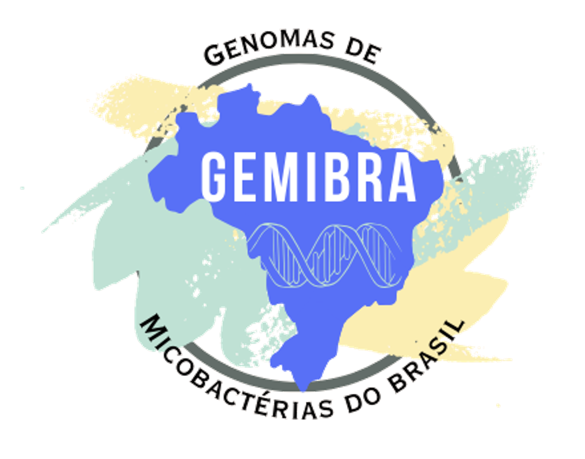

# **Ge**nomas De **Mi**cobactérias No **Bra**sil
## GEMIBRA v.2.0

## Português

### Bem-vindo ao Projeto GEMIBRA!
Esta plataforma digital é dedicada à agregação de dados públicos de sequenciamento genômico (Whole-Genome Sequencing - WGS) de micobactérias isoladas no Brasil. Nosso objetivo é promover a pesquisa e apoiar ações de saúde pública de precisão, com foco na vigilância em saúde.

### Sobre nós
Somos uma equipe interdisciplinar de pesquisadores e educadores, incluindo professores, estudantes de graduação e pós-graduação, com atuação em instituições renomadas de pesquisa e ensino:

* Instituto Evandro Chagas (IEC) – Pará, Brasil
* Instituto Oswaldo Cruz (FIOCRUZ) – Rio de Janeiro, Brasil
* Universidade de Stellenbosch – Cidade do Cabo, África do Sul
* Escola de Higiene e Medicina Tropical de Londres – Faculdade Universitária de Londres, Reino Unido
* Consórcio REVIGET N/NE

Nosso foco está em compreender a diversidade genômica de micobactérias no Brasil e no mundo para melhorar a saúde pública por meio de pesquisa de ponta.

### Visão geral das micobactérias
As micobactérias englobam mais de 190 espécies, divididas em três grupos principais:

1. Complexo _Mycobacterium tuberculosis_ (CMTB) – Principal responsável pela tuberculose em humanos e animais.
2. Micobactérias Não Causadoras de Tuberculose (MNT) – Presentes em diversos ambientes, podendo causar infecções oportunistas.
3. _Mycobacterium leprae_ e _Mycobacterium lepromatosis_ – Principais causadores da hanseníase.

### Banco de dados GEMIBRA (Atualização: 04 de abril de 2026)
Nosso banco de dados fornece acesso público a genomas do CMTB e futuramente incluirá dados sobre MNT e _M. leprae_.

* **CMTB**: 2580 genomas
* **MNT**: Em andamento
* ***M. leprae***: Em construção

### Fale conosco
Se você deseja contribuir com o projeto ou tem dúvidas, envie-nos uma mensagem:  
**E-mail**: projetogemibra@gmail.com

## English

### Welcome to the GEMIBRA Project!
This digital platform is dedicated to aggregating public whole-genome sequencing (WGS) data from mycobacteria isolated in Brazil. Our goal is to promote research and support precision public health actions focused on health surveillance.

### About us
We are an interdisciplinary team of researchers and educators, including faculty members and undergraduate and graduate students, working across renowned research and education institutions:

* Evandro Chagas Institute (IEC) – Pará, Brazil
* Oswaldo Cruz Institute (FIOCRUZ) – Rio de Janeiro, Brazil
* Stellenbosch University – Cape Town, South Africa
* London School of Hygiene & Tropical Medicine – University College London, United Kingdom
* REVIGET N/NE Consortium

Our focus is to understand mycobacterial genomic diversity in Brazil and worldwide to improve public health through cutting-edge research.

### Mycobacteria overview
Mycobacteria include more than 190 species, divided into three main groups:

1. _Mycobacterium tuberculosis_ Complex (MTBC) – Main cause of tuberculosis in humans and animals.
2. Non-Tuberculous Mycobacteria (NTM) – Found in diverse environments and may cause opportunistic infections.
3. _Mycobacterium leprae_ and _Mycobacterium lepromatosis_ – Main causative agents of leprosy.

### GEMIBRA database (Updated: April 04, 2026)
Our database provides public access to MTBC genomes and will later include NTM and _M. leprae_ data.

* **MTBC**: 2580 genomes
* **NTM**: In progress
* ***M. leprae***: Under construction

### Contact us
If you would like to contribute to the project or have any questions, send us a message:  
**Email**: projetogemibra@gmail.com
 

<noscript></noscript>